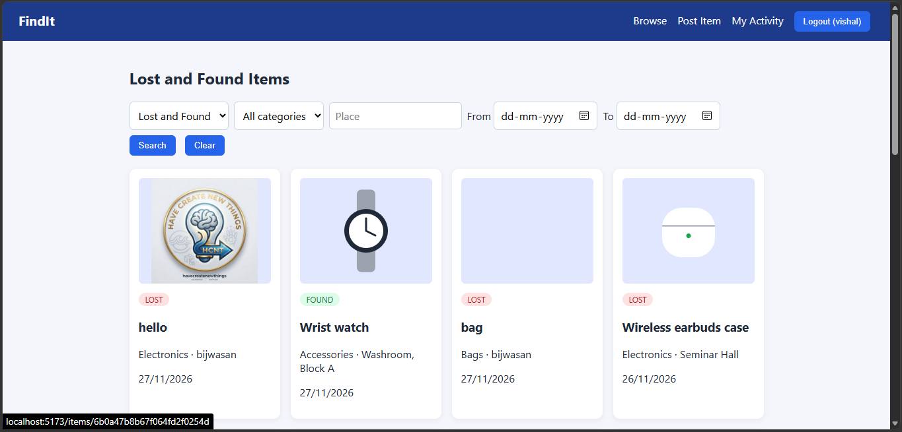
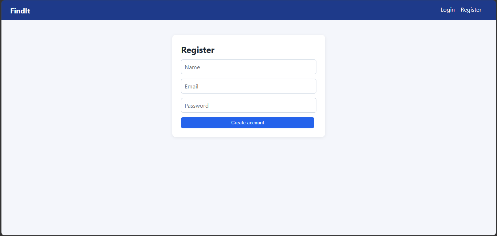
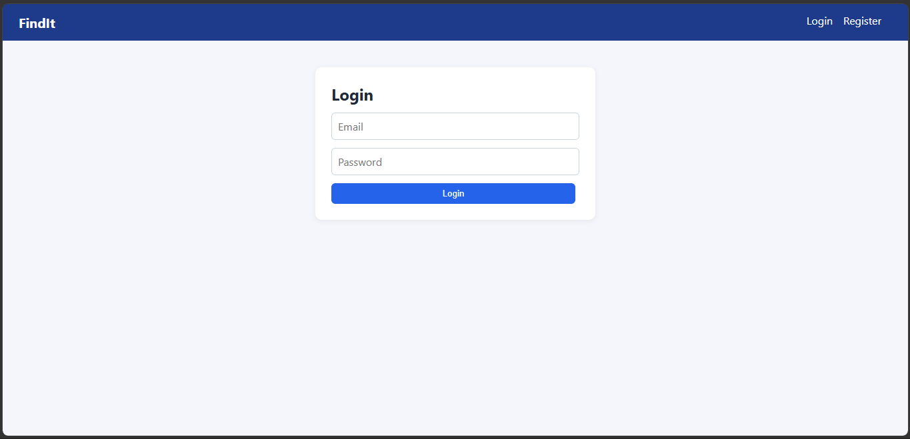
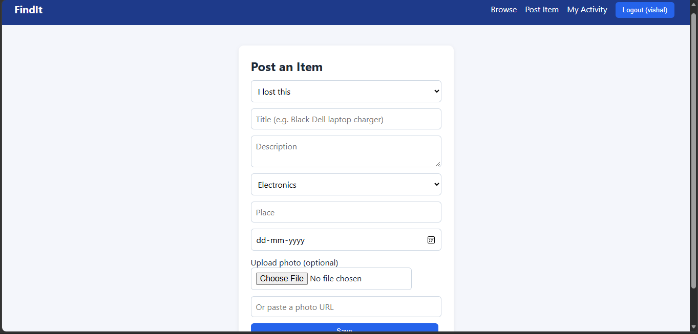
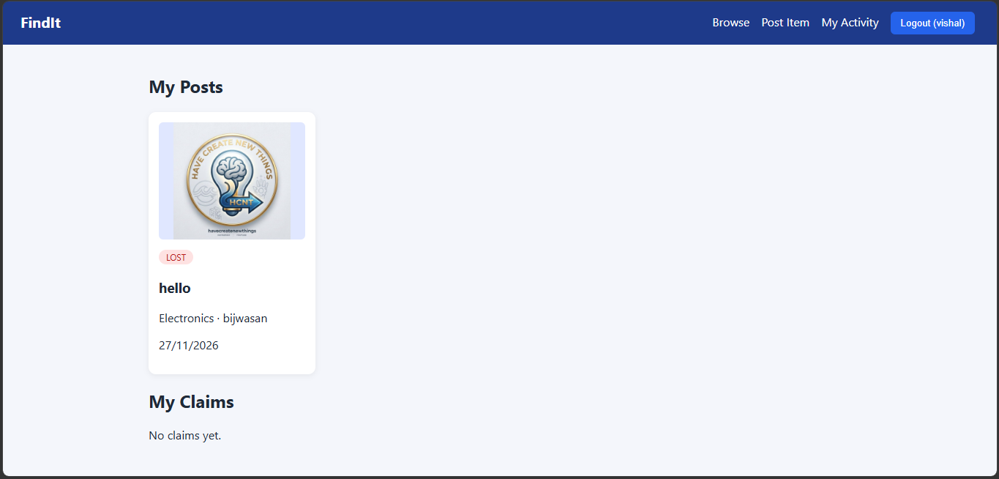

# FindIt - Campus Lost and Found

A MERN stack web portal where students post lost and found items, claim them, and get **possible match** suggestions.

**Author:** [Vishal Kumar Jha](https://github.com/vishalkumarjha192)
**Repository:** [web-dev](https://github.com/vishalkumarjha192/web-dev)

## Features
- Register and login with bcrypt password hashing
- JWT access and refresh tokens
- Two roles: **user** and **admin** (security staff)
- Post lost or found items with category, place, date and photo
- Upload a photo or paste a photo URL
- Search and filter by type, category, place and date
- Claim a found item; the finder approves or rejects the claim
- Admin can remove fake posts and view a category report
- **Possible matches:** found items with the same category, a similar title keyword and a date within 7 days of the lost item

## Tech Stack
| Part | Technologies |
|---|---|
| Frontend | React, React Router, Context API, Fetch API, Vite |
| Backend | Node.js, Express, Mongoose, dotenv, bcrypt, jsonwebtoken |
| Database | MongoDB |
| API testing | Postman |

## Screenshots
### Home


### Register


### Login


### Post an Item


### My Activity


## Folder Structure
```
findit/
├── backend/
│   ├── config/         database connection
│   ├── controllers/    business logic
│   ├── middleware/     authentication, RBAC, error handling
│   ├── models/         User, Item, Claim
│   ├── routes/         API routes
│   └── utils/          helper functions
├── frontend/
│   ├── public/images/  sample item pictures
│   └── src/            components, context, pages
├── postman/            API collection
└── screenshots/
```

## Getting Started
### Requirements
- Node.js 18.18 or newer
- MongoDB (local or MongoDB Atlas)

### 1. Clone the repository
```bash
git clone https://github.com/vishalkumarjha192/web-dev.git
cd web-dev/webdev_backend/All-Assignment/findit
```

### 2. Start the backend
```bash
cd backend
npm install
cp .env.example .env     # Windows: copy .env.example .env
npm run seed:admin
npm run seed:data        # optional sample items
npm run dev
```

### 3. Start the frontend (second terminal)
```bash
cd frontend
npm install
npm run dev
```
Open http://localhost:5173

## Environment Variables
| Variable | Purpose |
|---|---|
| PORT | Backend port (5050) |
| MONGO_URI | MongoDB connection string |
| ACCESS_TOKEN_SECRET | Secret for access tokens |
| REFRESH_TOKEN_SECRET | Secret for refresh tokens |
| ADMIN_EMAIL | Admin account email |
| ADMIN_PASSWORD | Admin account password |

## Demo Accounts (local use only)
| Role | Email | Password |
|---|---|---|
| Admin | admin@findit.com | Admin@123 |
| Student | aman@findit.com | Student@123 |
| Student | priya@findit.com | Student@123 |

## API Endpoints
| Method | Endpoint | Access |
|---|---|---|
| POST | /api/auth/register | Public |
| POST | /api/auth/login | Public |
| POST | /api/auth/refresh | Public |
| POST | /api/auth/logout | Logged in |
| GET | /api/auth/me | Logged in |
| GET, POST | /api/items | Logged in |
| GET | /api/items/:id | Logged in |
| PUT, DELETE | /api/items/:id | Owner |
| GET | /api/items/:id/matches | Logged in |
| POST | /api/claims/item/:itemId | Logged in, not the finder |
| GET | /api/claims/item/:itemId | Finder |
| PATCH | /api/claims/:id | Finder |
| GET | /api/claims/mine | Logged in |
| GET | /api/admin/report | Admin |
| DELETE | /api/admin/items/:id | Admin |

## Testing with Postman
1. Start the backend and run `npm run seed:admin`.
2. Import `postman/FindIt.postman_collection.json`.
3. Run the collection in order.

## Concepts Covered
- MVC architecture
- Schema validation and relationships
- Aggregation pipeline (category report)
- Database indexes
- Centralised error handling
- Role-based access control
- Protected routes in React

## Future Improvements
- Store tokens in httpOnly cookies
- Store photos in cloud storage
- Email notifications for claims
